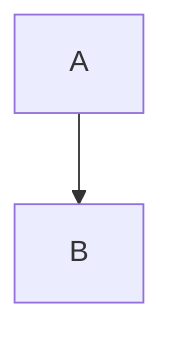

# Title

## Hello *world*

### Hello world

## Hello world

Paragraph with **strong**, *emphasis*, ~~gone~~ and [safe](https://example.com?a=1&b=2).

[unsafe](javascript:alert%281%29)


<script>alert('no')</script>

- one
- two

> Quote

| A | B |
| - | - |
| x | y |

```flow
Draft -> Review -> Publish
```



```js
const value = "hello";
console.log(value);
```
